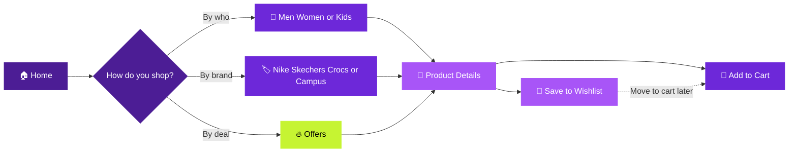

<table width="100%" align="center">
  <tr>
    <td width="20%" align="center" valign="middle">
      
    </td>
    <td width="60%" align="center" valign="middle">
      
    </td>
    <td width="20%" align="center" valign="middle">
      
    </td>
  </tr>
</table>

<div align="center">


<br/>

<a href="https://shahrishabh1513-jsk.github.io/RT_shoes_ecommerce/"></a>
<a href="https://shahrishabh1513-jsk.github.io/RT_shoes_ecommerce/offers.html"></a>
<a href="https://github.com/shahrishabh1513-jsk/RT_shoes_ecommerce"></a>
<a href="https://github.com/shahrishabh1513-jsk/RT_shoes_ecommerce/stargazers"></a>

<br/>


<br/>


</div>

<br/>

<div align="center">

[](#-live-preview)
[](#-about-the-project)
[](#-key-features)
[](#-site-pages)
[](#-user-workflow)
[](#-tech-stack)
[](#-folder-structure)
[](#-getting-started)
[](#-connect)

</div>

<div align="center"></div>

## 🔍 Live Preview

<div align="center">

<table width="90%">
<tr>
<td>🔴 🟡 🟢 &nbsp;&nbsp; <code>shahrishabh1513-jsk.github.io/RT_shoes_ecommerce</code></td>
</tr>
<tr>
<td align="center">
<a href="https://shahrishabh1513-jsk.github.io/RT_shoes_ecommerce/" target="_blank">

</a>
</td>
</tr>
</table>

<br/>

<table width="90%">
<tr>
<td align="center" width="50%">
<b>👞 Men</b><br/><br/>
<a href="https://shahrishabh1513-jsk.github.io/RT_shoes_ecommerce/men.html" target="_blank">

</a>
</td>
<td align="center" width="50%">
<b>🔥 Offers</b><br/><br/>
<a href="https://shahrishabh1513-jsk.github.io/RT_shoes_ecommerce/offers.html" target="_blank">

</a>
</td>
</tr>
</table>

<br/>

<a href="https://shahrishabh1513-jsk.github.io/RT_shoes_ecommerce/" target="_blank"></a>

</div>

> 💡 The store builds its pages with JavaScript, and the screenshots are captured live by a free service. If one shows blank on first load, refresh once and it fills in within a minute.

<div align="center"></div>

## 📖 About The Project

<table>
<tr>
<td width="60%" valign="top">

**RT SHOES** is a modern, premium **multi-brand footwear e-commerce website** featuring **Nike, Skechers, Crocs and Campus** collections for **Men, Women and Kids**.

You can browse by category or by brand, check out the current offers, open a product's detail page, and keep your picks in a **wishlist** and a **cart** — all inside a responsive interface with smooth animations.

It's built with plain **HTML5, CSS3 and JavaScript** — no frameworks and no build step.

> 👟 *Step into your style.*

</td>
<td width="40%" valign="top">

| At a glance | |
|---|---|
| 👟 **Type** | Multi-brand footwear store |
| 🏷️ **Brands** | Nike · Skechers · Crocs · Campus |
| 👥 **For** | Men · Women · Kids |
| 📄 **Pages** | 12 |
| 🧱 **Stack** | HTML · CSS · JavaScript |

</td>
</tr>
</table>

<div align="center"></div>

## ✨ Key Features

<table>
<tr>
<td width="50%" valign="top" align="center">


<div align="left">

- A dedicated page for each brand
- **Nike**, **Skechers**, **Crocs** and **Campus**
- All the collections in one storefront

</div>

</td>
<td width="50%" valign="top" align="center">


<div align="left">

- **Men**, **Women** and **Kids** pages
- Browse by who you're shopping for
- Same clean layout on every page

</div>

</td>
</tr>
<tr>
<td width="50%" valign="top" align="center">


<div align="left">

- A dedicated **Offers** page
- **Product details** page for a closer look
- Interactive shopping features

</div>

</td>
<td width="50%" valign="top" align="center">


<div align="left">

- **Wishlist** page for the pairs you love
- **Cart** page to review your picks
- Keep shopping across pages

</div>

</td>
</tr>
<tr>
<td width="50%" valign="top" align="center">


<div align="left">

- Modern, premium look
- Smooth animations
- Fully **responsive** on phone, tablet & desktop

</div>

</td>
<td width="50%" valign="top" align="center">


<div align="left">

- Pure HTML, CSS & JavaScript
- No frameworks, no build tools
- MIT licensed — free to learn from

</div>

</td>
</tr>
</table>

<div align="center"></div>

## 📄 Site Pages

<div align="center">

| Page | What's on it | Open |
|:---:|---|:---:|
| 🏠 **Home** | Landing page — "Step into your style" | [](https://shahrishabh1513-jsk.github.io/RT_shoes_ecommerce/) |
| 👞 **Men** | Footwear for men | [](https://shahrishabh1513-jsk.github.io/RT_shoes_ecommerce/men.html) |
| 👠 **Women** | Footwear for women | [](https://shahrishabh1513-jsk.github.io/RT_shoes_ecommerce/women.html) |
| 👟 **Kids** | Footwear for kids | [](https://shahrishabh1513-jsk.github.io/RT_shoes_ecommerce/kids.html) |
| ✔️ **Nike** | Nike collection | [](https://shahrishabh1513-jsk.github.io/RT_shoes_ecommerce/nike.html) |
| 👣 **Skechers** | Skechers collection | [](https://shahrishabh1513-jsk.github.io/RT_shoes_ecommerce/skechers.html) |
| 🐊 **Crocs** | Crocs collection | [](https://shahrishabh1513-jsk.github.io/RT_shoes_ecommerce/crocs.html) |
| 🏃 **Campus** | Campus collection | [](https://shahrishabh1513-jsk.github.io/RT_shoes_ecommerce/campus.html) |
| 🔥 **Offers** | Current deals | [](https://shahrishabh1513-jsk.github.io/RT_shoes_ecommerce/offers.html) |
| 🔎 **Product details** | A closer look at a single pair | opened from a product |
| 💜 **Wishlist** | Pairs you've saved | [](https://shahrishabh1513-jsk.github.io/RT_shoes_ecommerce/wishlist.html) |
| 🛒 **Cart** | Your cart | [](https://shahrishabh1513-jsk.github.io/RT_shoes_ecommerce/cart.html) |

</div>

<div align="center"></div>

## 🧭 User Workflow



<div align="center"></div>

## 🧰 Tech Stack

<div align="center">

| Layer | Technology | Purpose |
|:---:|:---:|:---|
| **Structure** |  | One page per category, brand and feature |
| **Styling** |  | Responsive layout, premium theme & animations |
| **Logic** |  | Page rendering, wishlist, cart & interactions |
| **Version Control** |   | Source control |
| **Hosting** |  | Live deployment |

</div>

<p align="center"><b>No build tools · No <code>npm install</code> · No frameworks — pure HTML, CSS and JavaScript.</b></p>

<div align="center"></div>

## 📂 Folder Structure

<details>
<summary><b>Click to expand the folder structure 📁</b></summary>

```bash
RT_shoes_ecommerce/
│
├── assets/              # Images & logos (add rt-shoes-logo.png for this README)
├── css/                 # Stylesheets
├── js/                  # JavaScript
│
├── index.html           # Home
├── men.html             # Men
├── women.html           # Women
├── kids.html            # Kids
├── nike.html            # Nike
├── skechers.html        # Skechers
├── crocs.html           # Crocs
├── campus.html          # Campus
├── offers.html          # Offers
├── product-details.html # Product details
├── wishlist.html        # Wishlist
├── cart.html            # Cart
│
├── LICENSE              # MIT License
└── README.md
```

</details>

<div align="center"></div>

## 🚀 Getting Started

<table width="100%">
<tr>
<td width="40%" valign="top">

**Option 1 — Shop online**

No setup needed 👉 **[Open RT SHOES](https://shahrishabh1513-jsk.github.io/RT_shoes_ecommerce/)**

</td>
<td width="60%" valign="top">

**Option 2 — Run it locally**

```bash
git clone https://github.com/shahrishabh1513-jsk/RT_shoes_ecommerce.git
cd RT_shoes_ecommerce

# open index.html in your browser
# (or use Live Server in VS Code)
```

</td>
</tr>
</table>

> ℹ️ The pages need **JavaScript enabled** to render.

<div align="center"></div>

## 🎯 Roadmap

<table>
<tr>
<td width="50%" valign="top">

**✅ Done**
- [x] Four brand pages — Nike, Skechers, Crocs, Campus
- [x] Men, Women & Kids pages
- [x] Offers & product details pages
- [x] Wishlist & cart pages
- [x] Responsive layout with smooth animations

</td>
<td width="50%" valign="top">

**🚧 Up next**
- [ ] 🔧 Backend for real orders
- [ ] 💳 Payment gateway
- [ ] 🔍 Search, sorting & filters
- [ ] 👤 Customer accounts
- [ ] 🌙 Dark mode

</td>
</tr>
</table>

<div align="center"></div>

## 📜 License

Released under the **MIT License** — see the [LICENSE](https://github.com/shahrishabh1513-jsk/RT_shoes_ecommerce/blob/main/LICENSE) file for details.

<div align="center"></div>

## 🤝 Connect

<div align="center">

**Rishabh Alpeshabhai Shah**

<a href="https://rishabh-shah-portfolio.netlify.app/"></a>
<a href="https://www.linkedin.com/in/rishabh-alpeshabhai-shah-91b9072a6/"></a>
<a href="mailto:shahrishu1515@gmail.com"></a>
<a href="https://github.com/shahrishabh1513-jsk"></a>

<br/>

### ⭐ If you like this project, give it a star — it helps a lot!


**Made with 👟 & 💜 by Rishabh Shah**


</div>
